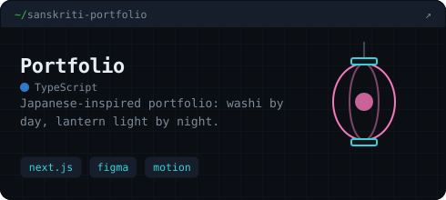
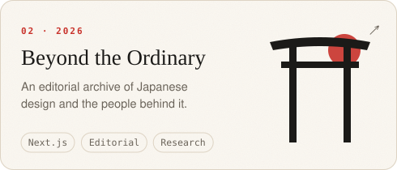
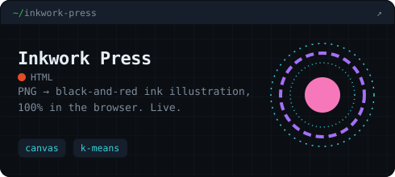
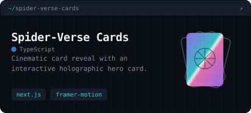

<div align="center">

<picture>
  <source media="(prefers-color-scheme: dark)" srcset="./assets/hero-dark.svg" />
  
</picture>


<a href="https://www.linkedin.com/in/sanskritiguptaa/"></a>
<a href="https://twitter.com/GuptaSanskritii"></a>
<a href="https://www.instagram.com/sanskritixart/"></a>
<a href="https://sanskritigupta.hashnode.dev/"></a>
<a href="mailto:sanskritigupta0005@gmail.com"></a>


</div>

<br/>

## 🌸 &nbsp;About me

```ts
const sanskriti = {
  role:    "Product Designer",
  studied: "Bachelor's in Computer Science",
  then:    ["C++", "DSA", "LeetCode", "Hacktoberfest", "web apps"],
  now:     ["Figma", "Claude Code", "Next.js", "Framer Motion"],
  loves:   ["Japanese design", "ma (empty space)", "sketching & painting"],
  motto:   "If I can design it, I can build it.",
};
```

I used to write code for grades. Now I design products, and I **vibe code** the ones I care about: Figma first, then Claude Code until it looks and moves exactly the way I drew it.

<br/>

## 🧭 &nbsp;How I work now

<picture>
  <source media="(prefers-color-scheme: dark)" srcset="./assets/process-dark.svg" />
  
</picture>

<br/>

## 🏮 &nbsp;Things I've made

<div align="center">

<a href="https://github.com/SanskritiGupta05/sanskriti-portfolio">
<picture>
  <source media="(prefers-color-scheme: dark)" srcset="./assets/card-portfolio-dark.svg" />
  
</picture>
</a>
<a href="https://github.com/SanskritiGupta05/beyond-the-ordinary">
<picture>
  <source media="(prefers-color-scheme: dark)" srcset="./assets/card-beyond-dark.svg" />
  
</picture>
</a>
<a href="https://inkwork-press.vercel.app">
<picture>
  <source media="(prefers-color-scheme: dark)" srcset="./assets/card-inkwork-dark.svg" />
  
</picture>
</a>
<a href="https://github.com/SanskritiGupta05/glitchbox">
<picture>
  <source media="(prefers-color-scheme: dark)" srcset="./assets/card-glitchbox-dark.svg" />
  
</picture>
</a>
<a href="https://github.com/SanskritiGupta05/spider-verse-cards">
<picture>
  <source media="(prefers-color-scheme: dark)" srcset="./assets/card-cards-dark.svg" />
  
</picture>
</a>
<a href="https://github.com/SanskritiGupta05/AniQuotes-Chrome-Extension">
<picture>
  <source media="(prefers-color-scheme: dark)" srcset="./assets/card-aniquotes-dark.svg" />
  
</picture>
</a>

</div>

<br/>

## 🛠️ &nbsp;Toolkit

<table>
<tr>
<td width="50%" valign="top">

**Now: design + vibe coding**


 

</td>
<td width="50%" valign="top">

**Then: my CS days**


<sub>DSA · LeetCode · open source · technical blogging</sub>

</td>
</tr>
</table>

<details>
<summary><b>🎓 &nbsp;More from my CS student days</b></summary>
<br/>

- [**DSA**](https://github.com/SanskritiGupta05/DSA) and [**LeetCode Submissions**](https://github.com/SanskritiGupta05/LeetCode-Submissions): interview prep, one problem at a time
- [**AniQuotes API**](https://github.com/SanskritiGupta05/AniQuotes): the little API behind the Chrome extension
- [**Quick Quiz**](https://quick-quiz-eight.vercel.app), [**Translator API**](https://github.com/SanskritiGupta05/translator-api-project), [**Bookstore MERN app**](https://github.com/SanskritiGupta05/Bookstore-mern-app), [**QR code generator**](https://github.com/SanskritiGupta05/qr-code-generator)
- Open source contributions during Hacktoberfest, and technical blogs on [Hashnode](https://sanskritigupta.hashnode.dev/)

</details>

<br/>

## 📈 &nbsp;Activity

<div align="center">

<picture>
  <source media="(prefers-color-scheme: dark)" srcset="https://streak-stats.demolab.com?user=SanskritiGupta05&background=161412&border=2C2926&stroke=2C2926&ring=E04A3A&fire=E04A3A&currStreakNum=EDE6D8&sideNums=EDE6D8&currStreakLabel=E04A3A&sideLabels=9A9183&dates=9A9183&border_radius=16" />
  
</picture>

<br/><br/>

<picture>
  <source media="(prefers-color-scheme: dark)" srcset="https://raw.githubusercontent.com/SanskritiGupta05/SanskritiGupta05/output/snake-dark.svg" />
  
</picture>

</div>

<br/>

<picture>
  <source media="(prefers-color-scheme: dark)" srcset="./assets/footer-dark.svg" />
  
</picture>
