<div align="center">

<picture>
  <source media="(prefers-color-scheme: dark)" srcset="./assets/tech-hero-dark.svg" />
  
</picture>


<a href="https://www.linkedin.com/in/sanskritiguptaa/"></a>
<a href="https://twitter.com/GuptaSanskritii"></a>
<a href="https://www.instagram.com/sanskritixart/"></a>
<a href="https://sanskritigupta.hashnode.dev/"></a>
<a href="mailto:sanskritigupta0005@gmail.com"></a>


</div>

<br/>

## `>_` &nbsp;about.ts

```ts
const sanskriti = {
  role:    "Product Designer",
  studied: "Bachelor's in Computer Science",
  then:    ["C++", "DSA", "LeetCode", "Hacktoberfest", "web apps"],
  now:     ["Figma", "Claude Code", "Next.js", "Framer Motion"],
  loves:   ["Japanese design", "ma (empty space)", "sketching & painting"],
  motto:   "If I can design it, I can build it.",
};
```

I used to write code for grades. Now I design products, and I **vibe code** the ones I care about: Figma first, then Claude Code until it looks and moves exactly the way I drew it.

<br/>

## `⚙` &nbsp;how-i-work.yml

<picture>
  <source media="(prefers-color-scheme: dark)" srcset="./assets/tech-process-dark.svg" />
  
</picture>

<br/>

## `</>` &nbsp;stack

<table>
<tr>
<td width="50%" valign="top">

**`$ now`** &nbsp;design + vibe coding


 

</td>
<td width="50%" valign="top">

**`$ git log --before=design`** &nbsp;CS days


<sub>DSA · LeetCode · open source · technical blogging</sub>

</td>
</tr>
</table>

<details>
<summary><b><code>cd ~/cs-days</code> &nbsp;more from my CS student days</b></summary>
<br/>

- [**DSA**](https://github.com/SanskritiGupta05/DSA) and [**LeetCode Submissions**](https://github.com/SanskritiGupta05/LeetCode-Submissions): interview prep, one problem at a time
- [**AniQuotes API**](https://github.com/SanskritiGupta05/AniQuotes): the little API behind the Chrome extension
- [**Quick Quiz**](https://quick-quiz-eight.vercel.app), [**Translator API**](https://github.com/SanskritiGupta05/translator-api-project), [**Bookstore MERN app**](https://github.com/SanskritiGupta05/Bookstore-mern-app), [**QR code generator**](https://github.com/SanskritiGupta05/qr-code-generator)
- Open source contributions during Hacktoberfest, and technical blogs on [Hashnode](https://sanskritigupta.hashnode.dev/)

</details>

<br/>

## `✎` &nbsp;blog.md

<a href="https://sanskritigupta.hashnode.dev/"><picture>
  <source media="(prefers-color-scheme: dark)" srcset="./assets/tech-blog-dark.svg" />
  
</picture></a>

<table>
<tr>
<td width="33%" valign="top">

**`apis/`**

- [Understanding HTTP, HTTPS and APIs](https://sanskritigupta.hashnode.dev/understanding-http-https-and-apis)
- [Theoretical concepts of APIs](https://sanskritigupta.hashnode.dev/theoretical-concepts-of-apis)
- [Build an API using NodeJS](https://sanskritigupta.hashnode.dev/build-an-api-using-nodejs)
- [Integrate Weather API into your website](https://sanskritigupta.hashnode.dev/integrate-weather-api-into-your-website)
- [My Keploy Fellowship Experience '23](https://sanskritigupta.hashnode.dev/my-keploy-fellowship-experience23)

</td>
<td width="33%" valign="top">

**`git-github/`**

- [Understanding Git & GitHub](https://sanskritigupta.hashnode.dev/understanding-git-and-github)
- [The very basics: git init & git status](https://sanskritigupta.hashnode.dev/the-very-basics-git-init-and-git-status)
- [git add & git commit](https://sanskritigupta.hashnode.dev/git-add-and-git-commit)
- [Getting started with GitHub](https://sanskritigupta.hashnode.dev/getting-started-with-github)
- [Create your first repository on GitHub](https://sanskritigupta.hashnode.dev/create-your-first-repository-on-github)

</td>
<td width="33%" valign="top">

**`community/`**

- [How to get started with programming](https://sanskritigupta.hashnode.dev/how-to-get-started-with-programming)
- [How I got into tech #WomenWhoTech](https://sanskritigupta.hashnode.dev/how-i-got-into-tech-womenwhotech)
- [My WeMakeDevs meetup experience](https://sanskritigupta.hashnode.dev/my-wemakedevs-meetup-experience)

</td>
</tr>
</table>

<p align="center"><a href="https://sanskritigupta.hashnode.dev/"></a></p>

<br/>

## `▲` &nbsp;git activity

<div align="center">

<picture>
  <source media="(prefers-color-scheme: dark)" srcset="https://streak-stats.demolab.com?user=SanskritiGupta05&background=0B0F14&border=22303F&stroke=22303F&ring=39D0D8&fire=A371F7&currStreakNum=E6EDF3&sideNums=E6EDF3&currStreakLabel=39D0D8&sideLabels=7D8B99&dates=7D8B99&border_radius=16" />
  
</picture>

<br/><br/>

<picture>
  <source media="(prefers-color-scheme: dark)" srcset="https://raw.githubusercontent.com/SanskritiGupta05/SanskritiGupta05/output/snake-dark.svg" />
  
</picture>

</div>

<br/>

<picture>
  <source media="(prefers-color-scheme: dark)" srcset="./assets/tech-footer-dark.svg" />
  
</picture>
